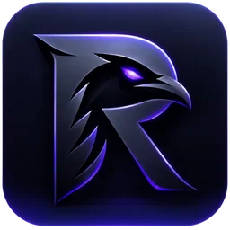

<!--
README DE PUBLICATION PREPARE — NON ACTIF.
Ce fichier n'est pas le README actuellement publié sur la page du dépôt.
Avant de le promouvoir manuellement vers README.md : fin de migration approuvée
par GhostPunishR, parité des fonctionnalités démontrée, vérification matérielle,
CI Android/iOS, sauvegardes, signature, liens et version de release.
Ne jamais automatiser cette promotion. Toute édition relève du propriétaire.
Les chemins ci-dessous sont écrits pour la RACINE du dépôt (promotion 1:1).
-->

<div align="center">



# RavenEmu

**Game Boy · Game Boy Color · Game Boy Advance**

*L'émulation portable, avec le moteur RavenCore.*

[](https://github.com/GhostPunishR/RavenEmu/actions/workflows/ci-applications.yml)
[](frontend/README.md)
[](android/README.md)
[](https://github.com/GhostPunishR/RavenEmu/releases)
[](LICENSE)

**[Télécharger](https://github.com/GhostPunishR/RavenEmu/releases) · [Site officiel](https://ghostpunishr.github.io/RavenEmu/) · [Documentation](wiki/Home.md) · [Signaler un problème](https://github.com/GhostPunishR/RavenEmu/issues)**

</div>

---

## À propos

**RavenEmu** est un émulateur open source dédié à la Game Boy, à la Game Boy Color et à la Game Boy Advance. Son moteur, **[RavenCore](https://github.com/GhostPunishR/RavenCore)**, reste développé en C++20 et indépendant de l'interface.

L'application privilégie une bibliothèque de jeux organisée, une expérience de jeu fluide, des commandes adaptées aux écrans tactiles et aux manettes ainsi que la maîtrise des données de sauvegarde.

## Fonctionnalités

| Domaine | RavenEmu |
| --- | --- |
| **Consoles** | Game Boy, Game Boy Color et Game Boy Advance |
| **Bibliothèque** | Import de ROMs personnelles, recherche, filtres, affichage en grille ou liste et jaquettes |
| **Commandes** | Contrôles tactiles et manettes compatibles |
| **Sauvegardes** | Mémoire de cartouche (SRAM), états de sauvegarde et gestion des emplacements |
| **Audio et vidéo** | Rendu et sortie sonore natifs, paramètres de lecture |
| **Fonctions avancées** | Skins, liaison entre joueurs et RetroAchievements, selon les fonctions validées pour la version publiée |

> Les fonctionnalités disponibles, plateformes et éventuelles restrictions sont précisées dans les notes de chaque version. Aucun jeu ni BIOS commercial n'est fourni.

## Télécharger et installer

La distribution publique est disponible depuis **[les Releases GitHub](https://github.com/GhostPunishR/RavenEmu/releases)**. Choisissez l'APK correspondant à la version annoncée et vérifiez ses notes de publication.

Sur Android, installez l'APK, lancez RavenEmu, puis importez uniquement des jeux que vous êtes autorisé à utiliser. Avant toute désinstallation, tout changement de signature ou toute migration de données, **exportez vos sauvegardes**.

Les versions iOS et les autres plateformes ne doivent être annoncées comme distribuées qu'avec une publication réelle. Les builds de développement ne sont pas des versions publiques signées.

## Architecture

RavenEmu sépare clairement le moteur, le frontend et les plateformes :

```text
RavenCore (C++20)           GB / GBC / GBA
        │
        ▼
ABI Libretro (C)
        │
        ▼
frontend/ (C)              Sessions et orchestration
        │
        ├── android/       Interface Java / JNI
        │    └── hardware/ Audio, vidéo et commandes Android
        └── iOS            Adaptation native selon validation
```

L'application et le frontend appartiennent à RavenEmu. **Libretro décrit une interface de cores**, pas la marque de l'application. Certaines portions de pilotes matériels adaptées de RetroArch conservent leurs licences et crédits : [provenance des sources](legal/attributions/retroarch.md).

La référence complète se trouve dans [ARCHITECTURE.md](ARCHITECTURE.md).

## Compiler et contribuer

Les commandes s'exécutent depuis la racine du dépôt. Elles nécessitent les outils Android/NDK, CMake et le JDK indiqués dans [BUILDING.md](BUILDING.md).

```bash
# Application Android (build de développement)
./gradlew :android:assembleDebug

# Frontend C et tests hôtes
cmake -S frontend -B build/native-frontend -DCMAKE_BUILD_TYPE=Release
cmake --build build/native-frontend --parallel 2
ctest --test-dir build/native-frontend --output-on-failure
```

Pour contribuer : [guide des contributions](CONTRIBUTING.md), [architecture](ARCHITECTURE.md) et [journal des changements](CHANGELOG.md).

## Sécurité, confidentialité et licences

RavenEmu n'inclut aucune ROM commerciale. L'application est indépendante de Nintendo et des fabricants de consoles. Le respect des droits d'auteur des jeux revient à leurs utilisateurs.

[Confidentialité](PRIVACY.md) · [Sécurité](SECURITY.md) · [Licence GNU AGPL-3.0](LICENSE) · [Attributions](legal/attributions/retroarch.md)

<div align="center">

**RavenEmu · By GhostPunishR**

</div>
